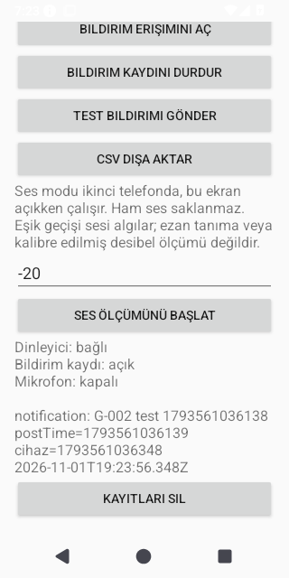

# G-002 emülatör doğrulama kanıtı

`CONFIRMED`: Android API 35, x86_64, temiz AOSP emülatörü üzerinde gerçek
`NotificationListenerService` callback'i ve CSV yazımı çalıştırıldı.
Bu kanıt gerçek telefon / ezan sesi / alarm güvenilirliği kabulü değildir.

- Kaynak commit: `798920dd38f1a15da6fac56ad0c5d5e178826359`.
- [Başarılı Actions koşusu](https://github.com/LoRdssssss/ezan-apk/actions/runs/41341256111).
- Koşunun `notif-logger-debug` artefaktı: APK + Kotlin lisansları,
  ID `13096404919` (indirmek için GitHub oturumu gerekir).
- Koşunun `notif-logger-verification` artefaktı: ham CSV, ekran görüntüsü
  ve test raporları, ID `13097580930`.
- [CSV örneği](notification.csv), [zaman karşılaştırması](result.txt).
- Koşu zamanı: 1 Kasım 2026, 22:23:56 (Europe/Istanbul);
  emülatörün saat dilimi `Etc/UTC`, CSV'deki an `19:23:56.348Z`.

CSV'deki `post_time_ms=1793561036139`, Android'in aktif bildirimindeki
`postTime` ile birebir eşleşti. Callback cihaz saati `1793561036348`;
fark **209 ms**, gönderim / gözlem aralığı `1793561036136..1793561036440`
içinde. ISO zamanı, kanal kimliği, ses URI'si, titreşim ayarı ve kanal önem
seviyesi sistem değerleriyle karşılaştırıldı. Kurulu APK'de `INTERNET` ve
`ACCESS_NETWORK_STATE` izinleri olmadığı doğrulandı.

PNG, `UiAutomation.takeScreenshot()` çıktısıdır; düzenlenmedi. CSV hücreleri
aynı koşunun gerçek çıktısıdır; bu depodaki örnekte yalnızca satır sonları
LF'ye normalize edildi. Ham artefakttaki CSV CRLF biçimindedir. Kanıt sadece
kendi ürettiğimiz test bildirimini içerir; kişisel hesap / içerik kullanılmadı.
Artefaktlar süreli saklanır; aşağıdaki görüntü ve CSV depoda kalıcıdır.

